<h1 align="center">shiori-shell</h1>

<p align="center">
  A desktop shell and dotfiles for <a href="https://hyprland.org">Hyprland</a>, built with
  <a href="https://quickshell.org">Quickshell</a>.<br>
  Every color comes from your wallpaper.
</p>

<p align="center">
  <a href="#features">Features</a> ·
  <a href="#installation">Installation</a> ·
  <a href="#keybindings">Keybindings</a> ·
  <a href="#configuration">Configuration</a> ·
  <a href="#extras">Extras</a> ·
  <a href="#uninstall">Uninstall</a>
</p>

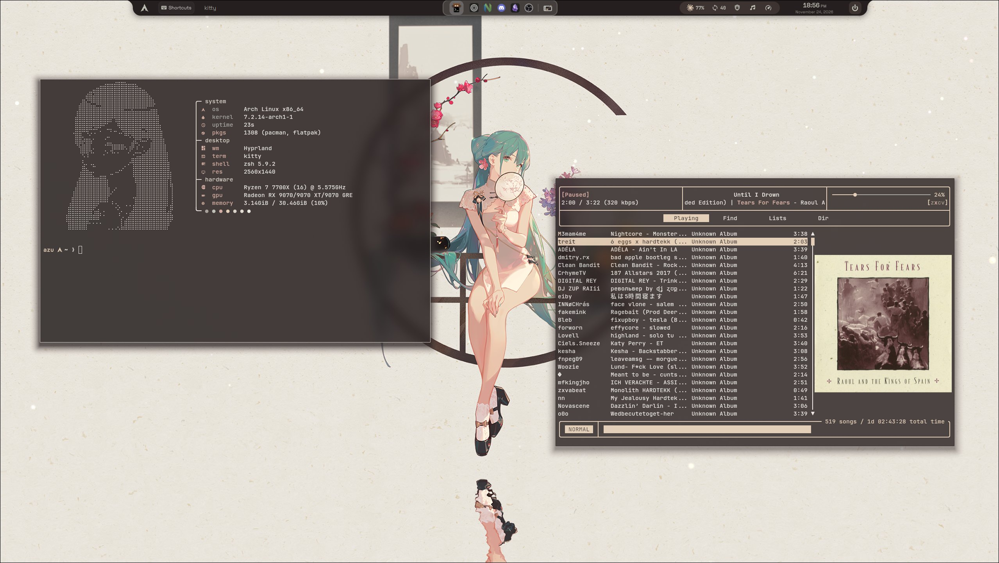

Change the wallpaper, and the bar, terminals, editor, GTK and Qt apps and a few more follow with a smooth fade.

<p align="center">
  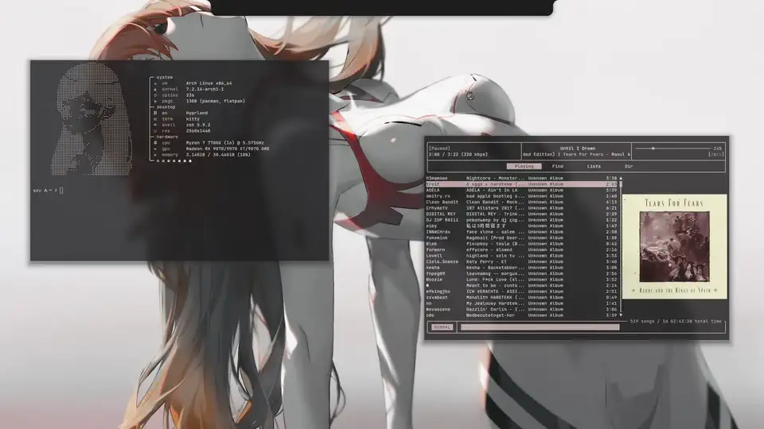
  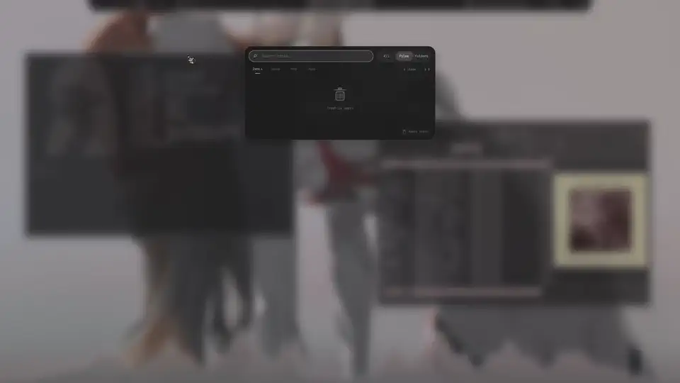
</p>
<p align="center">
  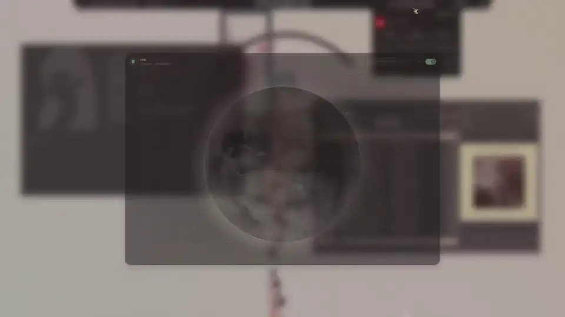
  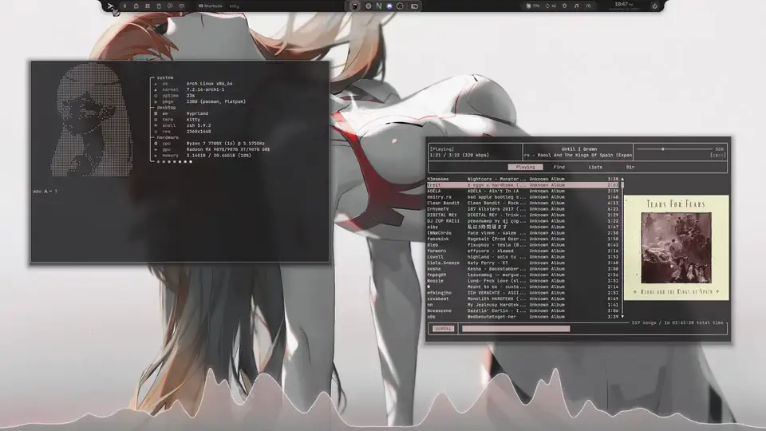
</p>
<p align="center">
  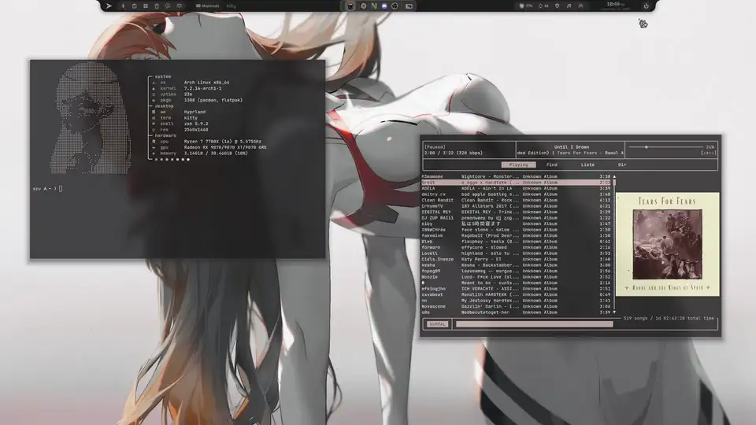
  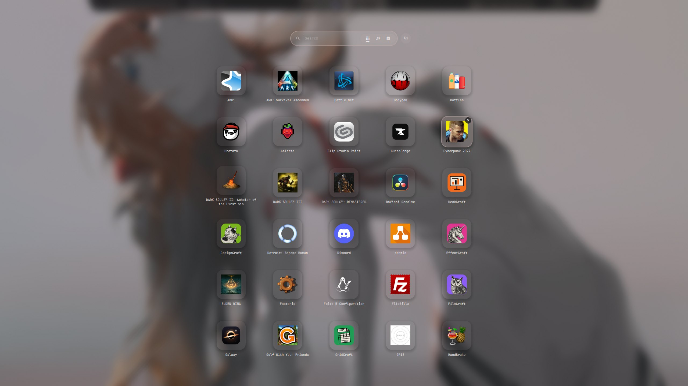
</p>

<details>
<summary>More screenshots</summary>

| | |
|---|---|
| 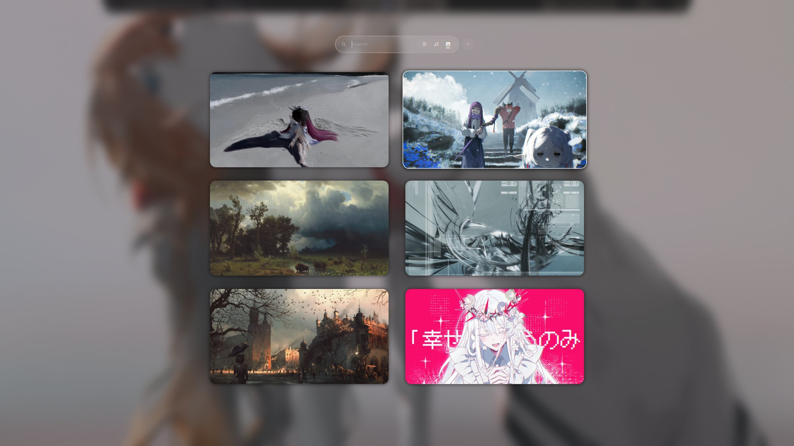 | 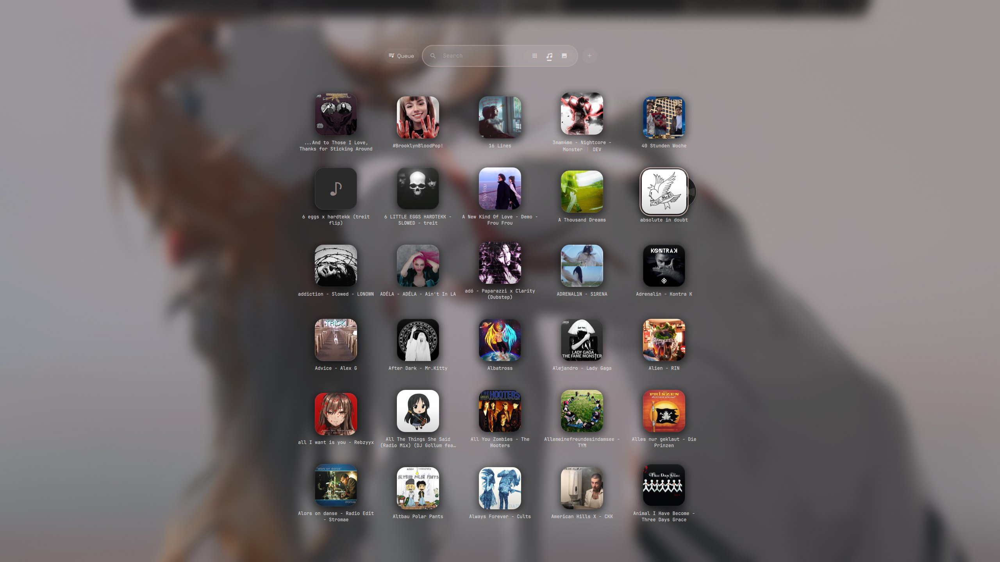 |
| 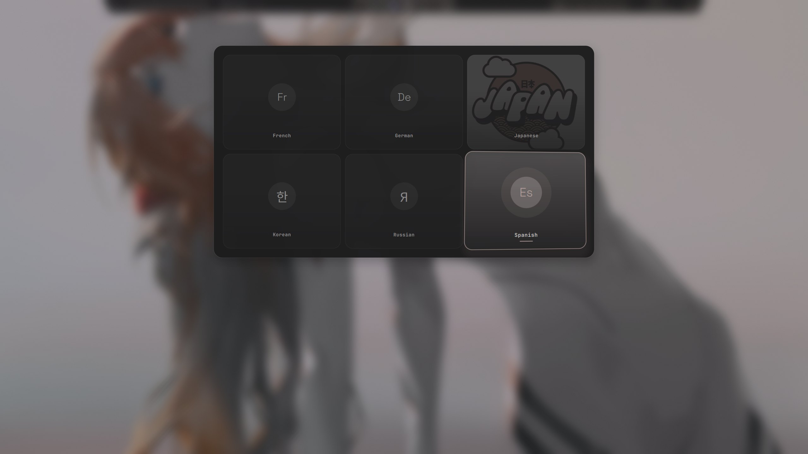 | 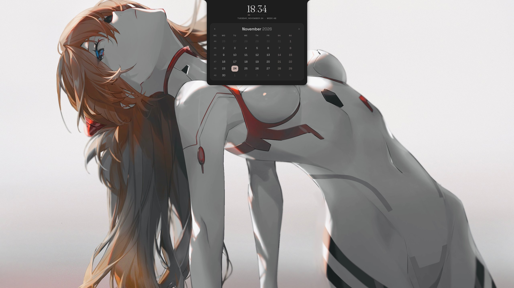 |
| 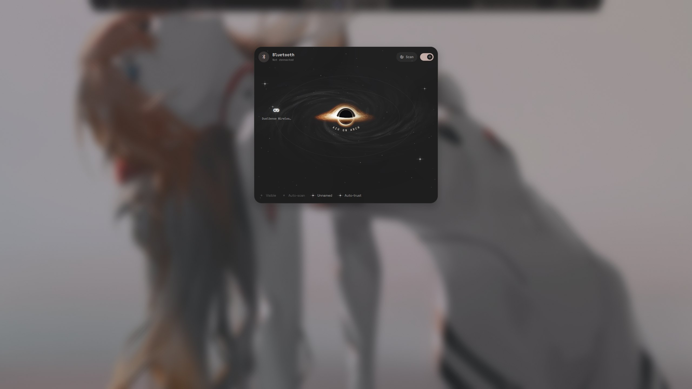 | 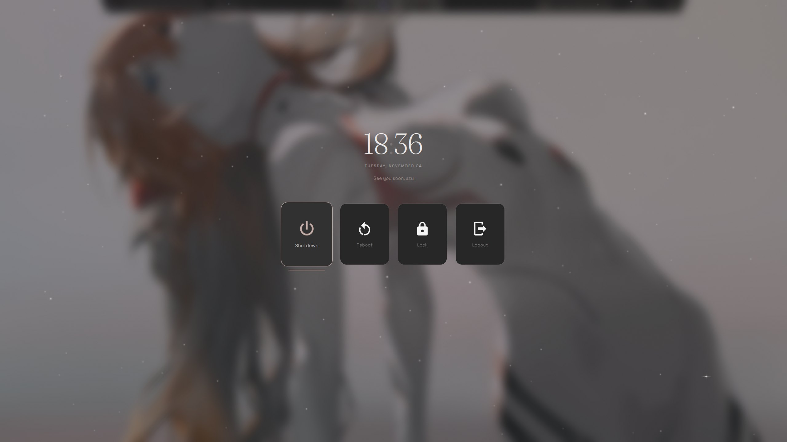 |

</details>

## Features

**Bar**
- Workspaces, active window, clock with calendar, notifications
- Drawer with shortcuts to the pickers (clipboard, trash, Wi-Fi, Bluetooth, apps, language tool)
- Dropdowns for audio, system stats (CPU, GPU, RAM, disks), VPN, battery, sync, and the usage
  limits of Claude Code and Codex
- Edit mode: right-click the logo on the left to hide or show icons. A hidden icon also turns its feature off.

**Pickers** (full-screen, keyboard first)
- App launcher and task manager
- Wallpapers, including animated ones (GIF, video) and an online search on wallhaven.cc
- Music library for MPD
- Clipboard history, trash, Wi-Fi, Bluetooth
- VPN picker with a globe

**Language learning tool**
- Videos with subtitles that follow the speech and translate line by line
- A reader for your own books in any language, with translation into English
- Transliteration for Cyrillic and Greek
- For Japanese: furigana, a dictionary and the free library Aozora Bunko

**Windows and tools**
- Lock screen, power menu, workspace overview (right-click the workspaces)
- Screenshot editor and video editor (trim, crop, compress with HandBrake)
- Encrypted folders (gocryptfs) that unlock with a password in the file browser and yazi
- Calculator, volume and brightness popups, notification toasts
- Audio visualizer on the desktop

**Colors from the wallpaper** (with [pywal](https://github.com/dylanaraps/pywal))
- Hyprland borders, Quickshell, kitty, Neovim, yazi, rmpc, tmux, cava
- GTK and Qt apps, cursor, fcitx5
- Steam (Millennium), Zen Browser, Helium, Vesktop, Obsidian, OBS, Telegram, OpenRGB, each only when installed

**Dotfiles** for Hyprland (Lua config), kitty, Neovim, tmux, yazi, MPD, rmpc, fastfetch and the starship prompt.

## Requirements

**Arch Linux.** The installer uses pacman; other distributions are planned.

Everything else comes with the installer, including Hyprland and Quickshell. If you already have them,
they need to be at least **Hyprland 0.57.1** (for the Lua config, `hyprland.lua`) and **Quickshell 0.3.2**.
Distributions with an older Hyprland (for example Debian stable) are not supported.

## Installation

```sh
git clone https://github.com/7azu/shiori-shell.git ~/shiori-shell
cd ~/shiori-shell
./install.sh
```

You enter your sudo password once at the start. Then the installer:

1. **Installs the packages** without asking: Hyprland, Quickshell, pywal, terminal tools, music (MPD, rmpc,
   cava), the fcitx5 input method, video and language tools, Bluetooth, battery and sync tools.
   - They come with a full system update (`pacman -Syu`), as Arch expects.
   - pywal is only in the AUR now. The installer takes its maintained continuation `python-pywal16` and
     sets up `paru` when you have neither `paru` nor `yay`.
   - Parts you do not use can be switched off later in the shell (right-click the logo in the bar).
2. **Links the configs** into `~/.config`. Anything already there is moved to
   `~/.config-backup-shiori-<date>` first.
3. **Sets up the rest**: the lock screen (`/etc/pam.d/quickshell-lock`), Bluetooth, the tmux plugins, the
   starship prompt and fastfetch in `~/.bashrc` / `~/.zshrc`, and the start of Hyprland after logging in on
   tty1 when you have no login screen.
4. **Asks for two extras**: [Zen Browser](#zen-browser) in the wallpaper colors and the
   [VPN killswitch](#vpn-killswitch) (off by default).

Then log out and log in again: Hyprland starts (with a login screen, choose Hyprland there). The first start uses the default wallpaper
(`~/Pictures/Wallpaper/shiori-default.jpg`, credits in `THIRD_PARTY.md`) and takes the colors from it.
Put your own wallpapers into `~/Pictures/Wallpaper` and pick one with `Super + W`, or search wallhaven.cc
right in the picker.

| Option | What it does |
|---|---|
| `--check` | only report missing programs, links and files |
| `--dry-run` | show what would happen, change nothing |
| `--no-packages` | only link the configs and set up the files |
| `--yes` | take the default answer for every question |
| `--verbose` | show the full output of pacman and the AUR helper instead of a spinner |
| `--uninstall` | remove the links and what the installer set up (asks before deleting any data) |

**Updating:** the repo stays where you cloned it, and `~/.config` only links to it. `git pull` updates everything.

## Keybindings

`Super` is the main key.

**Shell**

| Keys | Action |
|---|---|
| `Super + Space` | App launcher |
| `Super + W` | Wallpaper picker |
| `Super + M` | Music picker |
| `Super + G` | Clipboard history |
| `Super + X` | Trash |
| `Super + V` | VPN picker |
| `Super + J` | Language learning tool |
| `Super + T` | Task manager |
| `Super + N` | Notifications |
| `Super + K` | Calendar |
| `Super + P` | Power menu |
| `Super + Ctrl + L` | Lock screen |
| `Super + S` | Screenshot |
| `Super + Shift + S` | Screenshot into the editor |
| `Super + Shift + Q` | Restart the shell |

**Apps, windows and workspaces**

| Keys | Action |
|---|---|
| `Super + Q` | Terminal (kitty) |
| `Super + E` | File manager (yazi) |
| `Super + Shift + N` | Neovim |
| `Super + C` | Close window |
| `Super + B` | Toggle floating |
| `Super + F` / `Super + Shift + F` | Fullscreen / maximize |
| `Super + D` | Home workspace layout |
| `Super + H/L`, arrows | Move focus |
| `Super + Shift + H/J/K/L` | Move window |
| `Super + 1 … 0` | Switch workspace |
| `Super + Shift + 1 … 0` | Move window to workspace |

Media, volume, brightness and calculator keys work as expected. All bindings are in
`hypr/modules/keybindings.lua`. More shell actions (Wi-Fi, Bluetooth, airplane mode, moving the bar)
can be bound with `hl.dsp.global("quickshell:<name>")`; the names are listed in `quickshell/shell.qml`.

## Configuration

Your own settings live in `~/.config/shiori-shell/`, outside the repo, so `git pull` never touches them.

### settings.json

Merged over `quickshell/defaults/settings.json` key by key and reloaded on save. In paths, `~`, `$HOME`
and the XDG folders (`$PICTURES`, `$MUSIC`, `$DOCUMENTS`, `$DOWNLOAD`, `$VIDEOS`, `$DESKTOP`) are expanded.

```json
{
  "folders": {
    "wallpapers": "$PICTURES/Wallpaper",
    "screenshots": "$PICTURES/Screenshots",
    "music": "$MUSIC"
  },
  "sync": [
    { "id": "notes", "name": "Notes", "type": "git", "path": "~/Documents/Notes" },
    { "id": "drive", "name": "Drive", "type": "rclone", "remote": "gdrive:",
      "folders": [["~/Pictures", "Pictures"]] },
    { "id": "dots", "name": "Dotfiles", "type": "command",
      "check": ["~/bin/dots", "--check"], "run": ["~/bin/dots"] }
  ]
}
```

**`folders`**: where wallpapers, screenshots, music, language material and notes are.
- When you change `music`, change `music_directory` in `mpd/mpd.conf` to match.
- `projects` (your code folder) gives Neovim `Space fp`, a dashboard entry and, with the `claude` CLI,
  the tmux project layout.

**`sync`**: one row per entry in the sync dropdown. Without entries there is no sync icon.
- Types: `git` (commit, fetch, merge, push), `rclone` (bisync of folders), `command` (your own script).
- `"sshKey": true` unlocks your SSH key before a sync, `"sshKey": "~/.ssh/<key>"` uses that key instead.

**`icons`**: your own icons for apps or windows (files in `~/.config/shiori-shell/icons`).

**`translation`**: how the language tool translates book chapters and subtitle lines into English, from
any language. Set `provider` to one of these, or leave it on `auto`, which takes the first one that is ready
(in this order):

| `provider` | Needs |
|---|---|
| `claude` / `codex` | the [Claude Code](https://claude.com/claude-code) or [Codex](https://github.com/openai/codex) CLI, logged in |
| `ollama` | a local [Ollama](https://ollama.com) server with `ollamaModel` pulled (default `qwen2.5:7b`) |
| `deepl` | a [DeepL API](https://www.deepl.com/pro-api) key (the free plan works) in `$DEEPL_AUTH_KEY` or in `~/.config/shiori-shell/deepl.key` |
| `argos` | nothing: offline, no account. Set up on the first translation (about 270 MB in `~/.local/share`), rougher than the others |
| `off` | no translation |

### Hyprland

- **`~/.config/shiori-shell/hypr.lua`** is loaded last by `hyprland.lua`: the place for your own window
  rules, keybindings and autostart.
- **Monitors**: without a config, every monitor uses its preferred mode. For a fixed layout copy
  `hypr/modules/monitors.example.lua` to `hypr/modules/monitors.lua` (ignored by git).

### Terminal

New terminals start with fastfetch: a braille picture next to the system info. The installer adds it to
`~/.bashrc` / `~/.zshrc`, unless your shell config already runs it. To use your own picture (needs chafa):

```sh
~/.config/fastfetch/bin/animefetch-art IMAGE [WIDTH]
```

### Optional programs

Features whose program is missing are hidden, not broken. Run `./install.sh --check` to see what is installed.

## Extras

### Zen Browser

Zen follows the wallpaper colors with two extras, both set up by `./install.sh` (it offers to install Zen;
a Zen installed before gets the same setup):

1. The mod **Transparent Zen** (by sameerasw), downloaded from Zen's mod store into your profile. It draws the color.
2. **zen-live**, so the colors change live instead of Zen restarting.

If you install Zen later, run `./install.sh` again (or `sudo ~/.config/wal/zen-live/install.sh` and add the
mod in Zen's settings under Mods). The settings (fonts, website colors) go into your Zen profile on the next
wallpaper change.

### VPN killswitch

The VPN picker works with NetworkManager alone. The killswitch is optional: it blocks all traffic
outside the VPN and needs root parts (nftables rules, a boot service and a sudo rule for exactly four
`nft` commands). Install it only if you want it, with `./install.sh` or
`sudo quickshell/scripts/install-killswitch.sh`.

### Encrypted folders

The folder browser of the image and video editors and yazi can open encrypted folders made with
[gocryptfs](https://github.com/rfjakob/gocryptfs). A folder counts as a vault when a hidden folder with
the same name in lowercase sits next to it and contains `gocryptfs.conf`:

```sh
mkdir ~/Vault ~/.vault
gocryptfs -init ~/.vault
```

Entering `~/Vault` asks for the password. Leaving it (or quitting yazi with `q`) locks it again, and
gocryptfs locks it by itself after 3 minutes without use. In yazi, `Ctrl+L` locks it right away. No
previews of files inside a vault are written to the disk. Without such a folder nothing of this shows up.

### Wallpaper Engine

Animated scene wallpapers from Steam's Wallpaper Engine work in the wallpaper picker. They are not installed
by default, because they need the paid Wallpaper Engine on Steam:

```sh
paru -S linux-wallpaperengine-git
```

## Uninstall

Log out of Hyprland and run from a TTY:

```sh
./install.sh --uninstall
```

It undoes what the installer set up:

- removes the links in `~/.config` and moves your old configs back from `~/.config-backup-shiori-<date>`
- takes its lines out of your shell startup files (prompt, fastfetch, Hyprland autostart)
- removes `/etc/pam.d/quickshell-lock` and, if installed, the VPN killswitch and zen-live

The shell's caches and your settings in `~/.config/shiori-shell` are only deleted if you say so. Packages
stay installed (it shows how to remove them). Delete the repo afterwards.

## License

GPL-3.0, see [LICENSE](LICENSE). Fonts, flags and some templates come from other projects and keep
their own licenses: see [THIRD_PARTY.md](THIRD_PARTY.md).
